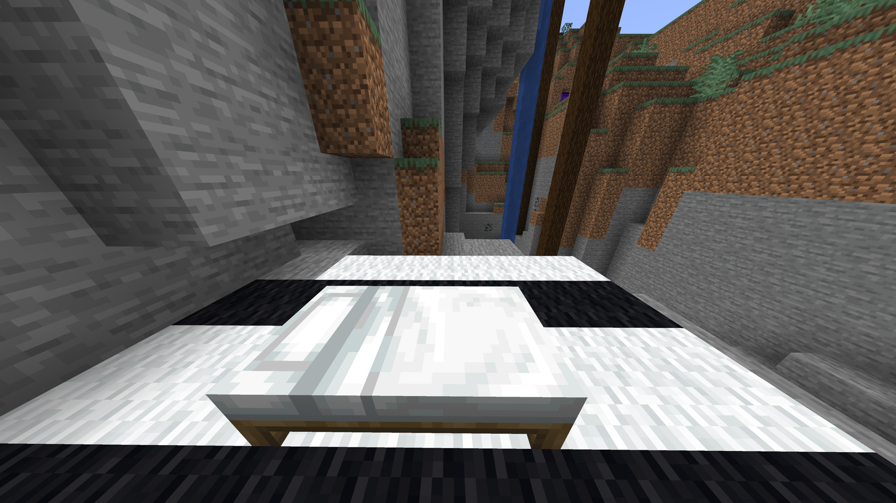
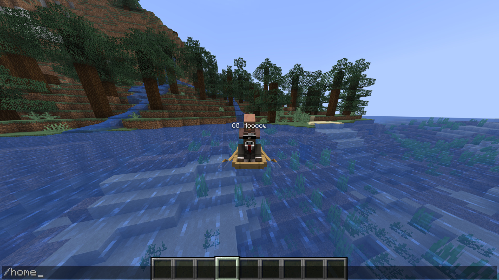
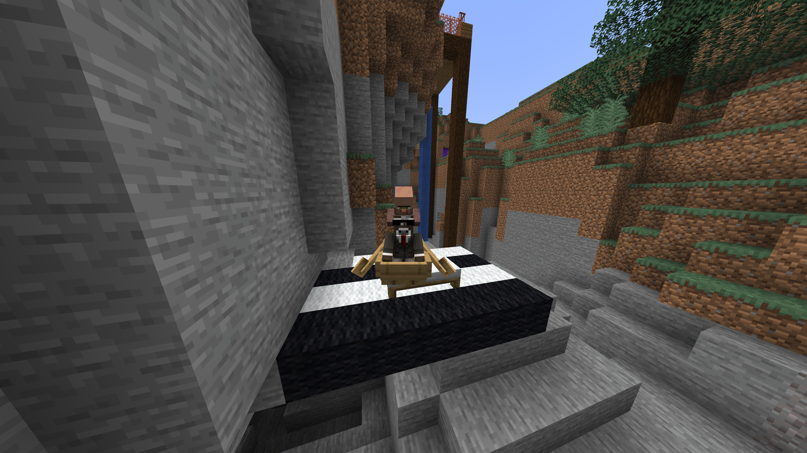
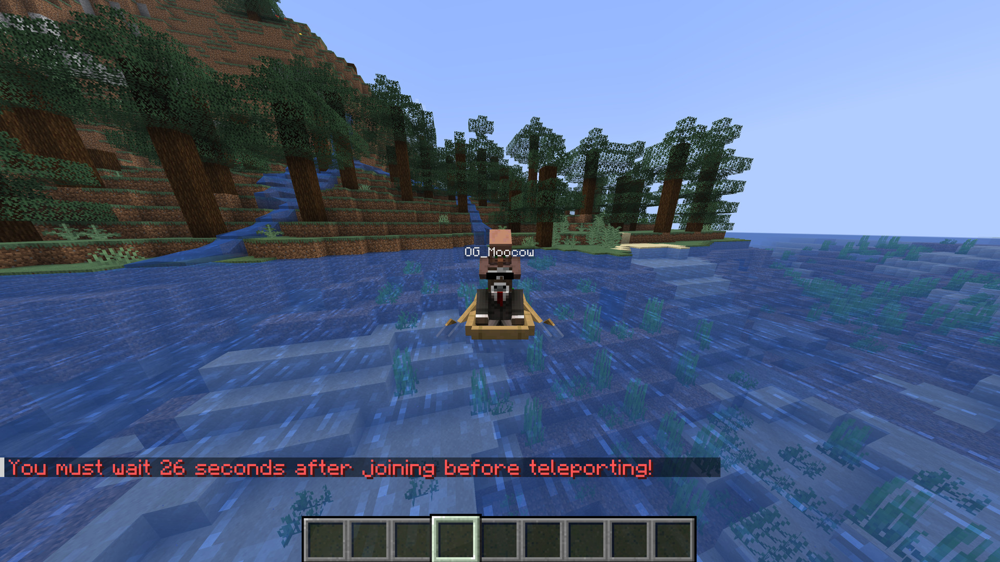

# OMWH — On My Way Home

OMWH is a server-side Fabric mod that adds `/home` and `/spawn` commands. Bring your boat, minecart or mount home with friends. Any mob, including other players, can come along as a passenger.

## Commands

- `/home` returns you to your bed or charged respawn anchor.
- `/spawn` takes you to world spawn, following the dimension settings below.
- `/home force` and `/spawn force` skip safety and vehicle-size checks. Cooldowns still apply. Force commands are available to everyone by default; server owners can disable them.

OMWH checks that the destination is safe and has room for your whole group before teleporting.

*Use `/home` without getting out of the boat.*

*The boat and its passengers arrive together.*

## Cross-dimension teleporting

Cross-dimension teleporting is enabled by default. `/home` returns you to your saved respawn point even when it's in another dimension. For example, you can return from the Nether to your Overworld bed, or from the Overworld to your charged respawn anchor in the Nether. Your vehicle and passengers come with you.

By default, `/spawn` takes you to Overworld spawn from any dimension. Enable `enableNetherSpawn`, `enableEndSpawn` or `enableModdedDimensionSpawn` to keep `/spawn` in that dimension instead. End routing uses Minecraft's End arrival point.

Set `enableCrossDimensionTeleport` to `false` to stop travel between dimensions. `/home` then requires your home to be in your current dimension. `/spawn` still works where that dimension's spawn route is enabled; otherwise it is blocked rather than sending you to the Overworld. `enableOverworldSpawn` controls access to Overworld spawn.

## Cooldowns

Cooldowns control how often players can teleport and prevent immediate escapes from combat. All four are enabled by default:

- **Regular — 30 seconds:** the wait after using `/home` or `/spawn`.
- **PvP — 45 seconds:** applies to both players when one damages the other.
- **Damage — 10 seconds:** applies after taking damage from other sources, such as mobs or falls.
- **Join — 30 seconds:** the wait after joining the server or opening a single-player world.

*Cooldown messages show the remaining wait.*

## Configuration

Edit `config/omwh.json` to change cooldowns, command names, messages, sounds, particles and dimension settings. Set a cooldown to `0` to disable it, then restart the server or reopen your single-player world to apply changes.

See the [configuration guide](CONFIGURATION.md) for all settings and defaults, or the [behavior guide](BEHAVIOR.md) for destination and passenger rules.

## Installation

For **OMWH 1.2.1**, you need:

- Minecraft 26.3
- Fabric Loader 0.19.5 or newer
- Fabric API for Minecraft 26.3 (the 1.2.1 release uses 0.161.0)
- Java 25 or newer

Download OMWH from [Modrinth](https://modrinth.com/mod/omwh).

- **Single-player:** put OMWH and Fabric API in your Fabric client's `mods` folder.
- **Multiplayer:** put both JARs in the server's `mods` folder. Players don't need either mod on their clients.

## Links

- [PyreHaven](https://pyrehaven.xyz)
- [Discord](https://discord.gg/tZ6Hx2ETA3)
- [Report an issue](https://github.com/ff-tech-xyz/omwh/issues)
- [Building and architecture](ARCHITECTURE.md)

## License

[CC0 1.0 Universal](LICENSE)
